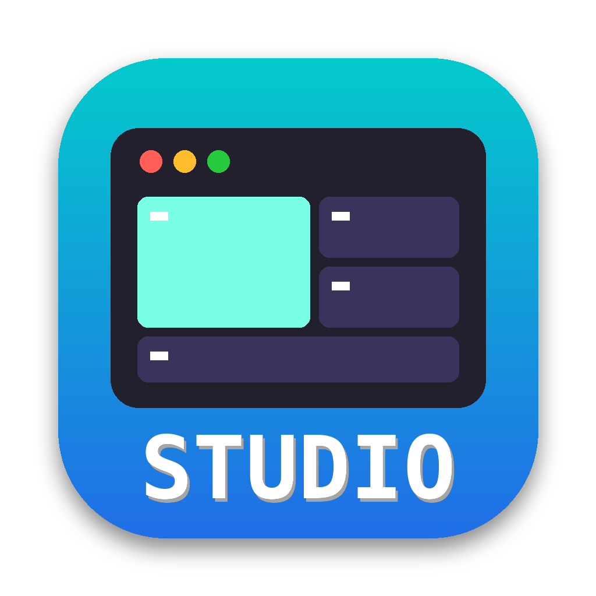

# ✦ Dev Studio

**Your AI dev team, one click away — and you can watch them talk.** Click the icon in your
Dock and a window opens with a team of coding-agent sessions already running, plus a
**board** that shows JEV routing every message between them: who sent what, who got it, how
sure the router was, and who is working on what. No guessing.



The team follows the cross-session blueprint, *Opus architects · Haiku relays · Sonnet executes*:

| Pane | Model | Job |
|---|---|---|
| **Architect** | Opus | sets the rules, evaluates contract changes, signs off before merge |
| **Main session** | Sonnet | builds the feature, syncs schemas, patches dependents |
| **Workers** (2 by default) | Haiku | small delegated tasks, each in its own copy of the project |
| **JEV router** | [TypeSafe Jev](https://typesafe.ai) (not an LLM session) | reads every peer message, decides who needs it, delivers it |
| **Board** | a script | the picture: cards, decision bars, mailbox, session log |

`studio up --codex` builds the same team with Codex instead of Claude Code.

**Built for Macs with limited memory.** Before starting, the Studio checks how much memory
is free and starts fewer workers if they wouldn't fit. Built on [Herdr](https://herdr.dev),
which keeps every agent running in the background and tells the board who is working, done,
or waiting on you.

## Install (once per Mac)

```bash
git clone https://github.com/rickndanger-ctrl/dev-studio.git ~/dev-studio
cd ~/dev-studio
./install.sh
```

It installs anything missing (Herdr, jq), saves your settings, adds a `studio` command, and
puts the **Dev Studio** icon in your Dock. For the JEV router, put your TypeSafe key in
`~/.zshrc`: `export TYPESAFE_API_KEY=…`. Without it the router falls back to plain rules.

## Every day

1. Click **Dev Studio** in the Dock and pick a project.
2. The window opens on the **board** tab. Switch to the **team** tab to talk to the architect.
3. Watch the board: every message the team sends crosses the router and shows up in the
   session log with JEV's decision (`p=0.91 sharp → @main`).

Click the icon again later and you're back in the same team, still running.

If OMAC (the window manager) is running, the studio opens inside an **OMAC terminal tile**
instead of a macOS Terminal window, so it sits in your tiled layout. Set `TERMINAL_APP` in
`~/.dev-studio/studio.conf` to `omac`, `ghostty`, `iterm` or `terminal` to force one.

## How a message travels

An agent runs `studio send <me> @peer "one-line note"` (or `auto`). The router asks Jev three
typed questions in one ~150 ms request — *which peer needs this first? forward, broadcast,
escalate or drop? is it a note or a pasted dump?* — then code decides: an unsure answer goes
to the architect, a dump is trimmed, and the note is delivered into the peer's terminal.
Each message is signed with a secret only its own pane has, so no agent can speak as another;
anything unsigned is delivered marked **UNVERIFIED**.

## The board

The board is a web page served by each Mac and opened beside the team when you click the
Dock icon. It draws the team as a chain, top to bottom:

```
            OPUS · session architect        ← plans, delegates, signs off
                      ┆ chain of command
            SONNET · main session           ← builds the feature
                      │
            JEV · message router            ← every message passes through here
            ┌─────────┴─────────┐
        @worker-1           @worker-2       ← small delegated tasks
```

The lines are the real channels. Every message an agent sends travels sender → JEV →
recipient, so when the architect hands the main session a task you see a pulse run down the
architect's line into JEV and up into the main session; each line keeps the last message that
crossed it and how long ago. Cards show each agent's state, what it is doing *right now*
(read from its terminal), and the last message it sent and received.

**Click anything.** An agent opens its live terminal, its messages and its status history. A
message in the feed (or on a line) opens Jev's full decision: every candidate peer with its
probability, the action probabilities, the token-leak check, latency, and whether the sender
was verified. JEV opens the router's recent decisions.

The **live feed** on the right is everything in time order: routes with their confidence,
deliveries, and every status change (`idle → working → done`). Filter it with the buttons.

## Watch from your laptop or phone

Each Mac serves its board as a web page, kept alive by launchd and reachable only over your
Tailscale network (your signed-in devices, nothing else):

- Mini 1: `http://100.64.0.1:8790`
- Mini 2: `http://100.64.0.2:8790`

Each page links to the other in its header. Any browser works — the Dell, an iPhone, an iPad.
`/health` on the same address returns the agent states as JSON for scripts.

## What keeps it running

The Herdr server and the web page both run under **launchd with KeepAlive**: if either dies,
macOS restarts it within seconds. If Herdr restarts and brings the space back without its
agents, the next click on the Dock icon rebuilds the team instead of reopening an empty room.

## Commands

| Command | What it does |
|---|---|
| `studio up [project] [--codex] [--router jev\|clef\|rules]` | open (or reopen) the team |
| `studio ask "note"` | dry run: what would the router decide for this note? |
| `studio send FROM @TO "note"` | send a note through the router (agents do this) |
| `studio web [start\|stop]` | the board as a web page (launchd keeps it up) |
| `studio doctor` | check everything is installed |
| `studio stop` | stop the studio's Herdr session and every agent in it |

Settings live in `~/.dev-studio/studio.conf` (`WORKERS`, models, `ROUTER`, `CLEF_URL`,
`SOUNDS`). Per-project state (mailbox, `router.log`, `team.json`) lives in `<project>/.studio/`,
kept out of git.

## For the next engineer
Read `HANDOFF.md`, `DESIGN.md` and `LESSONS.md`. Tests: `PATH="/bin:$PATH" /bin/bash test/run.sh`.

## Example build: camera-motion

`examples/camera-motion/` is the first project the studios built together (Mini 1: presets, sequences and docs; Mini 2: engine, previews, exports and web page). It's a stdlib-only Python package of cinematic camera moves — dolly, crane, orbit, pan, tilt, dolly zoom — with animated previews, exports to RealEstate10K, JSON, Blender and glTF, import and preset matching, and a local web page. Start with [its README](examples/camera-motion/README.md) and [tutorial](examples/camera-motion/docs/TUTORIAL.md).
