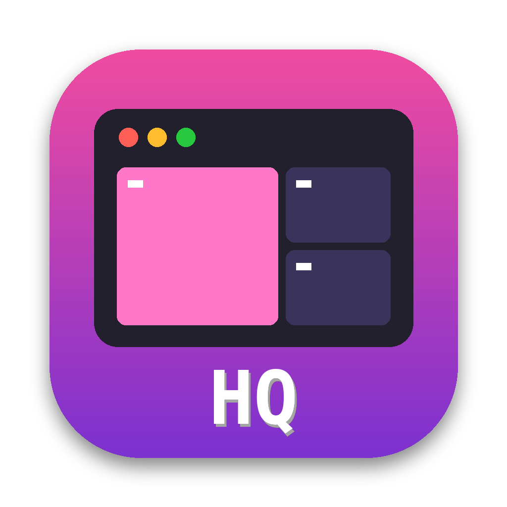
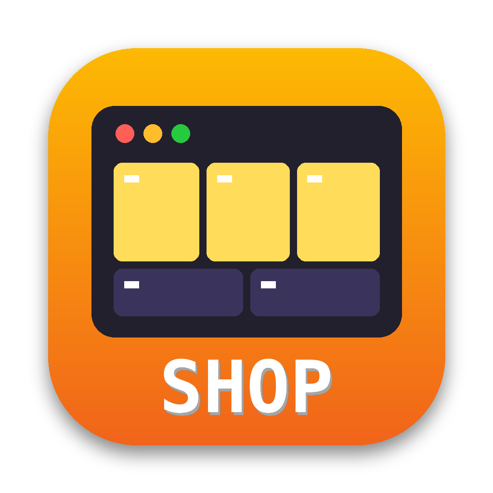

# ✦ Dev Studio

**Your AI dev team, one click away.** Click an icon in your Dock and a terminal opens with a
full team of Claude Code sessions already running, named, and able to message each other.

| Mini One · **Studio HQ** | Mini Two · **Studio Workshop** |
|---|---|
|  |  |
| 🏛 **Architect** (Opus): plans, assigns, approves | 🔨 **Builders** (Sonnet, or routed by Jev): write and test code |
| 📣 **Messenger** (Haiku): routes notes, keeps the status board | 📣 **Messenger** (Haiku) |
| ✨ **Studio dashboard** | ✨ **Studio dashboard** |

Built on [Herdr](https://herdr.dev), which keeps every agent running in the background,
restores the layout after a restart, and shows who's working, done, or waiting on you.

## Install (once per Mac)

```bash
git clone https://github.com/rickndanger-ctrl/dev-studio.git ~/dev-studio
cd ~/dev-studio
./install.sh hq          # on Mini One
./install.sh workshop    # on Mini Two
```

The installer installs Herdr and jq (via Homebrew), saves your settings, adds a `studio`
command, connects the two Minis, and puts the icon in your Dock.

## Every day

1. Click **Studio HQ** (or **Studio Workshop**) in the Dock.
2. Pick a project from the list.
3. Talk to the architect. It hands work to the builders, and they report back.

Click the icon again later and you're back in the same team, still running.

### The dashboard
| Light | Meaning |
|---|---|
| ⠋ spinning | working on it |
| 🔴 **NEEDS YOU** | waiting for your answer (you'll hear a ping) |
| ✅ | finished, take a look (you'll hear a chime) |
| 🟢 | ready for work |

## Commands

| Command | What it does |
|---|---|
| `studio up [project]` | open the team for a project |
| `studio doctor` | check everything is installed |
| `studio role hq\|workshop` | switch this Mac's role |
| `studio stop` | stop every agent |

Settings live in `~/.dev-studio/studio.conf`: builder count, models, router, sounds, terminal app.

## How the safety rules work

- Same-Mac messages are delivered straight away (`crossSessionInbound: accept`).
- Messages between the two Minis need your approval (`isolatePeerMachines: true`).
- A message from another agent is never treated as your approval, and each agent still asks
  before risky actions.
- Each builder works in its own git worktree, so builders never overwrite each other.
- Only the architect signs off on merges to `main`.

To let the two Minis' Claude sessions message each other, both need the same claude.ai
sign-in and [Remote Control](https://code.claude.com/docs/en/cross-session-messaging).

## Model routing (optional)

If `jev-claude` ([jev-router](https://github.com/gargpratyush/jev-router)) is installed,
builders launch through it, and Jev picks Haiku, Sonnet, or Opus for each turn. To use a
different router, set `ROUTER_CMD` in `~/.dev-studio/studio.conf`. The architect is pinned
to Opus and the messenger to Haiku.

## Lessons

[`LESSONS.md`](LESSONS.md) is added to every agent's role brief, so past mistakes aren't repeated.

## Development

```bash
test/run.sh               # end-to-end test against a mock Herdr
python3 assets/make_icons.py
```
