# camera-motion

<!-- anim:start -->
<table>
<tr><td align="center">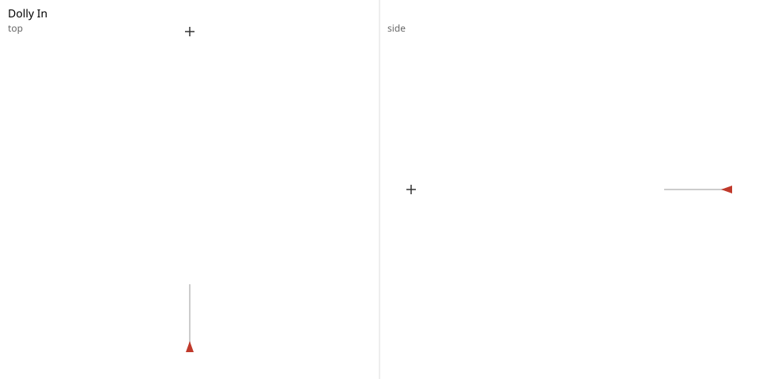 Dolly In</td><td align="center">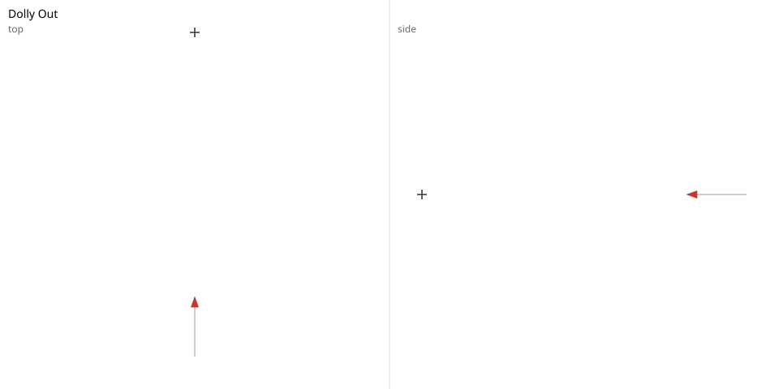 Dolly Out</td><td align="center">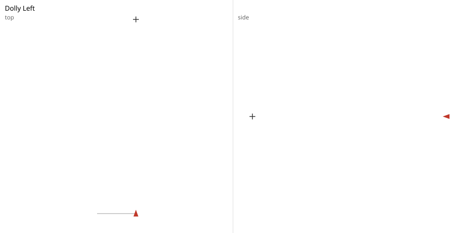 Dolly Left</td><td align="center">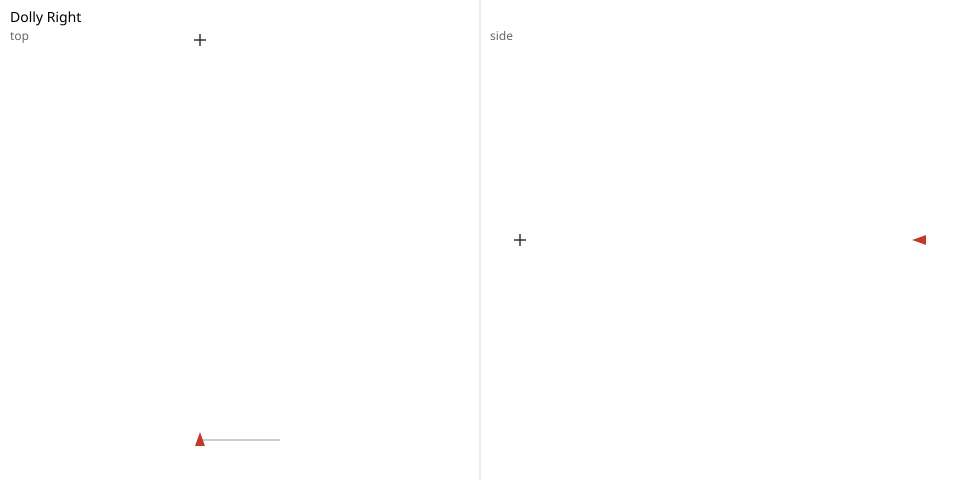 Dolly Right</td></tr>
<tr><td align="center">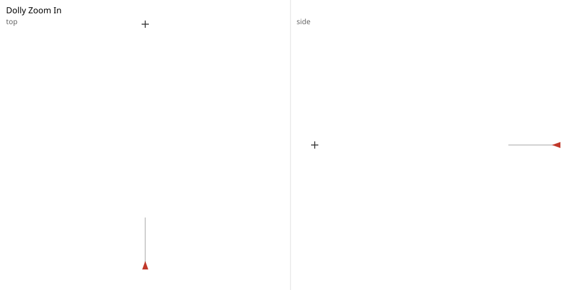 Dolly Zoom In</td><td align="center">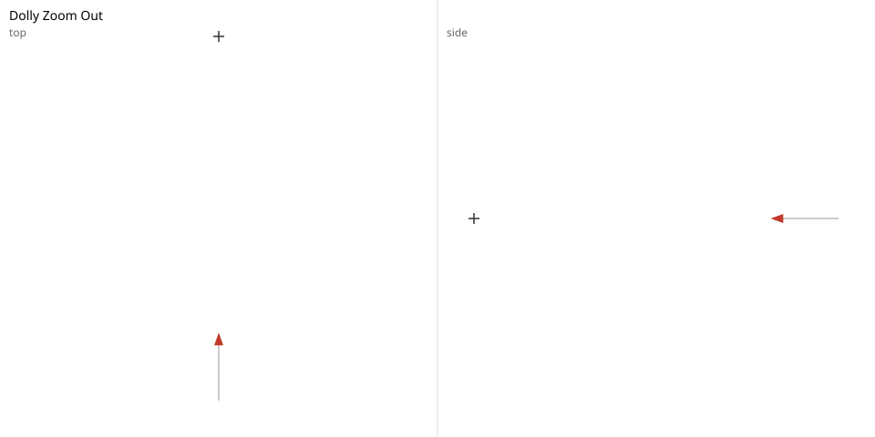 Dolly Zoom Out</td><td align="center">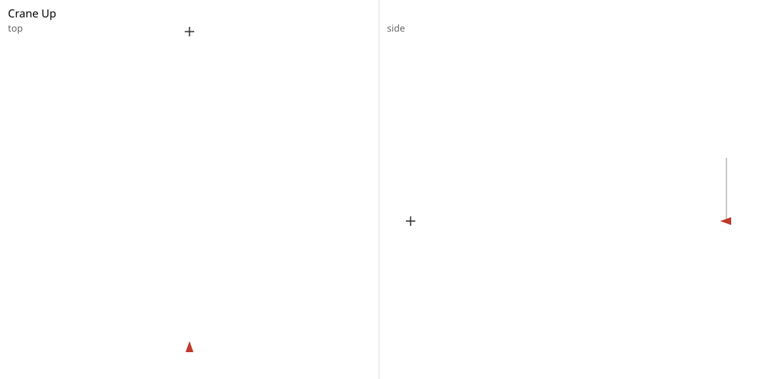 Crane Up</td><td align="center">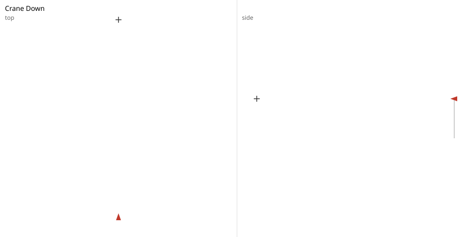 Crane Down</td></tr>
<tr><td align="center">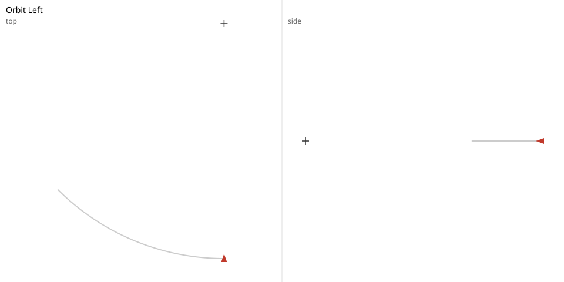 Orbit Left</td><td align="center">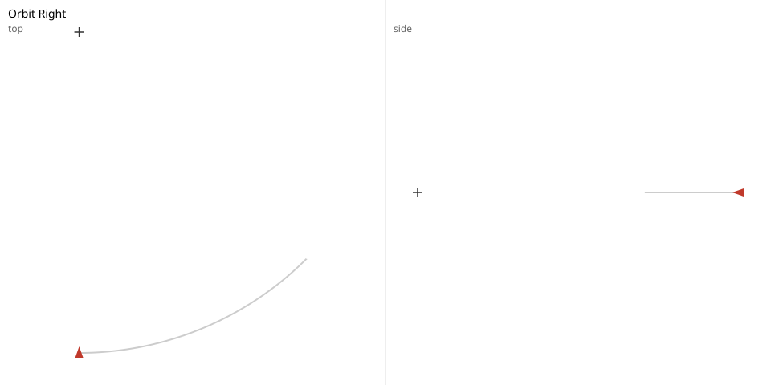 Orbit Right</td><td align="center">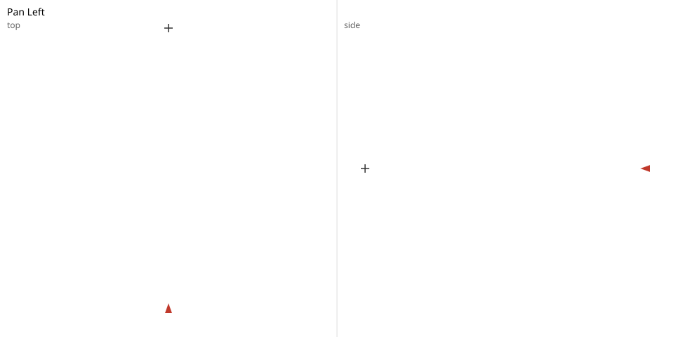 Pan Left</td><td align="center">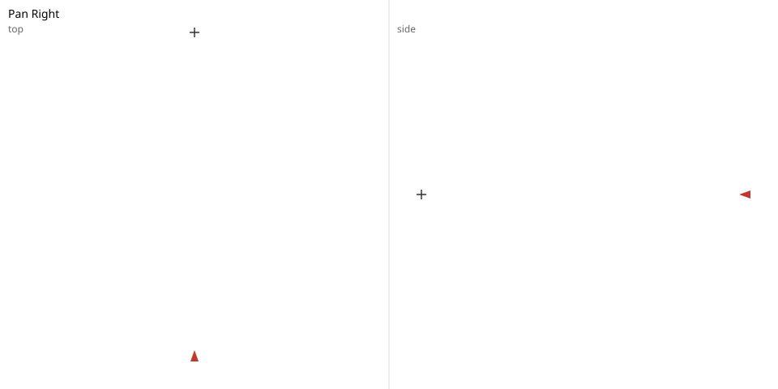 Pan Right</td></tr>
<tr><td align="center">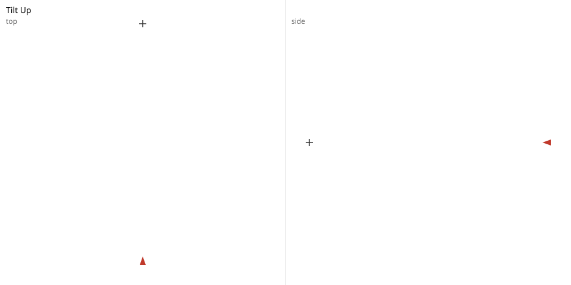 Tilt Up</td><td align="center">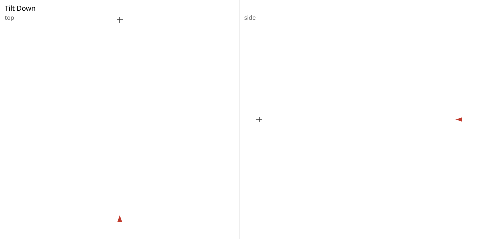 Tilt Down</td></tr>
</table>
<!-- anim:end -->

Camera moves for AI video. Describe a move (dolly, crane, orbit, pan, tilt, dolly-zoom) as a small
preset, get the per-frame camera path, preview it as an SVG or in the browser, and export it as a
camera trajectory for camera-controlled video models (CameraCtrl / MotionCtrl style).
Standard library only at runtime.

## Install

Python 3.9 or newer; no other dependencies.

    git clone <repo-url>
    cd dev-studio/examples/camera-motion
    python3 -m venv ~/venvs/camera-motion
    . ~/venvs/camera-motion/bin/activate
    pip install .
    camera-motion doctor    # every line should start with PASS

Release notes are in [CHANGELOG.md](CHANGELOG.md). A step-by-step walkthrough is in
[docs/TUTORIAL.md](docs/TUTORIAL.md).

## Commands

Presets are `{"type", "params", "easing"}`; the bundled catalog is
`camera_motion/presets/catalog.json` (14 presets).

| Command | What it does | Example |
|---|---|---|
| `list` | List the presets in the catalog | `camera-motion list` |
| `path` | Print a preset's first and last frame | `camera-motion path dolly_in` |
| `preview` | Draw a preset's path as an SVG | `camera-motion preview dolly_in -o dolly_in.svg` |
| `export` | Write a trajectory (`re10k`, `json`, `blender`, `gltf`) | `camera-motion export dolly_in --format re10k -o dolly_in.txt` |
| `serve` | Live preview page at http://127.0.0.1:8790/ | `camera-motion serve` |

## Conventions

- Units: scene units for distances, degrees for angles. Rotation is [yaw, pitch, roll].
- Default start: position [0, 0, 5], rotation [0, 0, 0], fov 50. At yaw 0 the camera looks down -z at the subject at the origin.
- +x is the camera's right when looking down -z. +y is up.
- +yaw turns the camera left. +pitch looks up.
- dolly: on x, +distance moves the camera right. On z, +distance moves toward the subject (z decreases).
- crane: +distance moves up.
- orbit: +angle makes the camera travel to its right around the subject, and yaw increases by the same angle so the camera keeps facing the subject. "Orbit left" is a negative angle. The distance eases from the start distance to params.radius, so frame 0 always equals the start pose.
- Every move: frame 0 equals the start pose exactly.

## Export

Turns engine frames into per-frame camera trajectories. Rotation is R = Ry(yaw) · Rx(pitch) · Rz(roll).

- **JSON** (`c2w`, `w2c`): OpenGL camera axes, the same as the engine. x right, y up, the camera looks down -z.
- **RE10K** lines: OpenCV camera axes, which RealEstate10K loaders expect. x right, y down, the camera looks down +z. This is the OpenGL w2c with its y and z rows negated.
- Intrinsics are normalized: vertical fov, fy = 0.5 / tan(fov/2), fx = fy · height / width, cx = cy = 0.5.
- Defaults: 24 fps, 3 seconds, 1024x576.

RE10K line format: `<timestamp_us> fx fy cx cy 0 0 <3x4 world_to_camera, row-major>`.
Line 0 is `# <preset name>`.

## Export to 3D tools

`--format blender` writes a Blender (`bpy`) script that keys a camera, one keyframe per frame.
`--format gltf` writes a glTF 2.0 camera animation.

    camera-motion export dolly_in --format blender -o dolly_in.py
    camera-motion export dolly_in --format gltf -o dolly_in.gltf

- **Blender:** run the script in Blender (Scripting tab, or `blender --python dolly_in.py`).
  Blender is Z-up and ours is Y-up, so positions are swapped (x, y, z) -> (x, -z, y). Camera axes
  are unchanged (Blender cameras also look down -z with +y up).
- **glTF:** no conversion needed, glTF is Y-up like the engine.
  The fov is taken from the first frame only (glTF cameras do not animate fov here).

## Sequences

A sequence chains presets into one shot. Three samples are bundled: `establishing`,
`house_walkup` and `product_reveal`. They also appear in the Sequences tab of the web viewer.

    camera-motion sequence establishing --preview -o establishing.svg

## Example: dolly_in

`dolly_in` moves the camera 1 unit toward the subject with `ease_in_out`, 3 s at 24 fps
(73 frames). Values from the engine:

    +-----+---+---+--------+-----+-------+-----+
    |  t  | x | y |   z    | yaw | pitch | fov |
    +-----+---+---+--------+-----+-------+-----+
    | 0.0 | 0 | 0 | 5.0000 |  0  |   0   | 50  |
    | 1.0 | 0 | 0 | 4.8519 |  0  |   0   | 50  |
    | 2.0 | 0 | 0 | 4.1481 |  0  |   0   | 50  |
    | 3.0 | 0 | 0 | 4.0000 |  0  |   0   | 50  |
    +-----+---+---+--------+-----+-------+-----+

## Tests

Run from the folder that contains pyproject.toml:

    python3 -W error -m unittest

## Troubleshooting

- **`camera-motion: command not found`**: activate the environment again with
  `. ~/venvs/camera-motion/bin/activate`.
- **`camera-motion serve` says `error: port N is in use`**: start it on another port, for example
  `camera-motion serve --port 8791`.
- **Check you reached the right page**: the browser tab is titled 'Camera motion'.
- **`camera-motion doctor` prints a FAIL line**: the line names the broken part; reinstall with `pip install .`.

## License

MIT. See [LICENSE](LICENSE).
