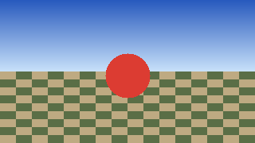

# video-studio

video-studio turns still pictures into short camera moves. You give it one photo, or a plan of
several photos, and it moves a virtual camera past them: a slow push-in, an orbit, a crane up.
It writes frames, a preview GIF and a manifest, and it can show the result in a web page.

It is built on [camera-motion](../camera-motion/), which holds the camera paths (the catalog of
moves such as `dolly_in` and `orbit_left`).

**This is an independent project. It is not affiliated with, or derived from, any company's
code.** We do not read, fetch or analyse competitors' sites, apps or code.

## What is in this folder

| Path | What it is |
|---|---|
| `stillmove/` | One still picture, one camera move: depth, warp, frames, GIF, and a web page |
| `shotplan/` | A plan of several shots, each moved by stillmove, joined with crossfades; a check, a timeline, and a web page |
| `docs/TUTORIAL.md` | Step by step: plan, check, render, watch |
| `docs/FEATURES.md`, `docs/SHORTLIST.md` | Which features are common, and the first build we chose |
| `MODELS.md` | The one optional depth model: where it comes from, its checksum, and its license |
| `tools/make_example.py` | Draws the test picture and renders the example GIFs in `docs/example/` |

## Install

You need Python 3.9 or newer. Keep this folder and `camera-motion/` side by side: `camera-motion` is
a pip package in that sibling folder, and `stillmove` uses it.

Run the commands below from the `video-studio/` folder (the one with `pyproject.toml`; from the
repository root, `cd video-studio` first). `../camera-motion` is the sibling folder, so
`pip install ../camera-motion` only works from `video-studio/`.

Put the virtual environment outside this folder, so the project stays clean:

    python3 -m venv ~/venvs/video-studio
    . ~/venvs/video-studio/bin/activate
    pip install numpy Pillow
    pip install ../camera-motion
    pip install .

`pip install .` from `video-studio/` gives two commands, `stillmove` and `shotplan`. Check the install:

    stillmove doctor

Without installing, run the same commands from `video-studio/` as `python3 -m stillmove.cli` and
`python3 -m shotplan`.

The default depth backends need nothing else. The learned depth backend (`da2-small`) is optional:
it also needs `pip install onnxruntime` and the model file described in `MODELS.md`. The examples
below do not use it.

## stillmove: one picture, one move

Render a still picture along a camera move. This example uses the test picture that
`tools/make_example.py` draws in code (a gradient sky, a checkerboard ground and a circle), and the
gradient depth backend, which is a fake that needs no model:

    stillmove render docs/example/input.png --preset dolly_in --backend gradient -o ~/video-tutorial/dolly-in

The output folder (outside the project, like every example here) holds the frames, `preview.gif` and `manifest.json`. An mp4 is written too if
`ffmpeg` is installed and you pass `--mp4`.

| Input | dolly_in | orbit_left |
|---|---|---|
|  |  |  |

## stillmove: mesh for Blender

`mesh` writes the still as a textured grid at its depth, plus `scene.py`, a Blender script that
keys the camera along the same path. The fake plane depth needs no model:

    stillmove mesh docs/example/input.png --preset dolly_in --depth fake --grid 32x18 -o ~/video-tutorial/mesh

`--depth` takes the same backends as `render` (plane, gradient, da2-small) or a grayscale `.png`
(white near, black far). Like `render`, the depth is smoothed once. In Blender, open the Scripting
tab, Text > Open `scene.py`, then Run Script (Alt+P).

## shotplan: several pictures, one timeline

A shot plan is a JSON file (see `shotplan/schema.json`). Each shot is one picture with one camera
sequence and a duration. A shot can crossfade into the next one. The sample
`shotplan/samples/product_reveal.json` uses placeholder cards in place of photos, so it runs without
any image files:

    shotplan check shotplan/samples/product_reveal.json
    shotplan render shotplan/samples/product_reveal.json ~/video-tutorial/product-reveal --scale 0.1

`check` prints the timeline (each shot's start and end, its moves with their durations, and its
transition) and exits 1 on any mistake. `render` checks the plan first, then writes one folder with
the joined GIF. Keep the output outside this folder, as the examples do.

## The web pages

All three pages run on 127.0.0.1 only and send nothing anywhere else.

**stillmove** (port 8800 by default). Start it, open http://127.0.0.1:8800/, and upload a picture
(up to 5 MB). The page renders it before it replies, then shows the preview GIF. Upload from the
command line with the same API:

    python3 -m stillmove.web.server 8800
    curl -s -F image=@docs/example/input.png -F preset=dolly_in -F backend=gradient http://127.0.0.1:8800/api/render

The reply is `{"id": ...}`. Fetch the job with `curl -s http://127.0.0.1:8800/api/jobs/<id>`. If the
port is taken the server says `error: port 8800 in use`; pass another port as the argument.

**shotplan** (port 8810 by default). Start it and open http://127.0.0.1:8810/ to see the sample
plans, check them live, and render a background preview:

    shotplan serve --port 8810

## makeclip: make a clip or a promo

The Make a clip page makes one clip from one picture, or a promo from two to six pictures. Start it
from `video-studio/` (or `makeclip --port 8820` after `pip install .`), then open
http://127.0.0.1:8820/:

    python3 -m makeclip --port 8820

Make a clip renders one picture with a camera move. Choose "Every size" to get the square, wide and
vertical versions in one render, each with its own download and a zip of all three. Make a promo renders several shots and joins
them, and can load a plan file. Pictures come from `~/Pictures/stillmove-input/`; clips go to a new
folder under `~/Pictures/stillmove-output/`. The server binds 127.0.0.1 only.

## The doctor

    stillmove doctor

One line per check, `PASS`, `WARN` or `FAIL`. The checks cover Python, Pillow, numpy, the
camera-motion import, a small fake render, ffmpeg, the depth model, onnxruntime, and the shot-plan
import and a small render. A `WARN` is allowed: ffmpeg is optional (mp4 is off without it), and the
depth model, onnxruntime and matte model are only needed for `da2-small` and the `isnet` matte (see
"Messages you may see"). The doctor exits 1 only on a `FAIL`.

## Messages you may see

**Keep the subject in frame** (`stillmove/fit.py`, see [`stillmove/FIT.md`](stillmove/FIT.md)). Before
`render` and `mesh` draw anything, the move is shortened just enough that the subject stays at least
6% of the frame inside the edges. When it shortens the move, `stillmove` prints a note on stderr:

    note: move shortened to 83% to keep the subject 6% inside the frame

The percentages change with your picture and move. If the subject is already that close to the edge
in the first frame, nothing can be saved, and the move is left as planned:

    note: subject is already within 6% of the edge in the first frame; move left as planned

`--no-fit` turns the shortening off, so the camera follows the move exactly as planned (the subject may then
touch or leave the frame). `--fit-margin F` changes the 6% (`0 < F < 0.4`).

**Doctor warnings.** `stillmove doctor` prints `WARN` lines for optional parts that are missing. Each
is safe to ignore unless you want that feature:

| Line | What to do |
|---|---|
| `WARN depth model: depth model not found at <path>; da2-small is off` | Only `--backend da2-small` needs it. Download the file named in `MODELS.md` to that path, or keep using `plane` or `gradient`. |
| `WARN onnxruntime: onnxruntime not installed; da2-small is off` | `pip install onnxruntime` if you want `da2-small` or the `isnet` matte. |
| `WARN matte model: matte model not found at <path>; the isnet matte is off` | Only `--matte isnet` needs it. Get the file named in `MODELS.md`, or use `--matte fake`. |
| `WARN ffmpeg: ffmpeg not found on PATH; mp4 output is off` | Install ffmpeg to get `--mp4`. GIF and frame output work without it. |

**A model that fails its checksum.** The depth and matte models are pinned by SHA256 in `MODELS.md`.
If the file at the path is not the pinned one, `stillmove` refuses to load it (and `doctor` prints a
`FAIL`):

    <path> does not match the pinned model: expected SHA256 <expected>, found <found>

Download the file again from the address in `MODELS.md` and check it.

## Honest limits

- **Single pictures reveal hidden areas.** A camera moves through one still image, so the image
  cannot show what is behind an object. Where the camera sees around an edge you get stretched
  pixels or empty areas that are filled in. The more the camera moves, the more this shows.
- **Keep orbits small.** An orbit swings the camera around the subject, so the hidden areas grow
  with the angle. The examples use small moves for this reason. Large orbits look wrong.
- **The default depth backends are fakes.** `plane` assumes a flat wall, and `gradient` assumes the
  top of the picture is far and the bottom is near. Real scenes will show stretched edges and holes.
  The optional `da2-small` backend estimates real depth, but only in relative terms, not in metres,
  and it needs a model download you do in advance (see `MODELS.md`).
- **Nothing is invented.** The warp moves the pixels you have. It does not paint in content that is
  not in the picture.
- **Nothing is sent over a network, and the default backends download nothing.** The web pages
  listen on 127.0.0.1 only. Rendered jobs live in a temporary folder that the server deletes when it
  stops.

## Example images

`docs/example/input.png`, `dolly_in.gif` and `orbit_left.gif` are generated by
`tools/make_example.py` from code. No photographs are used. Each image is listed in
`test_privacy.py` with its checksum and where it came from.
